# 🏛️ Samadhan Setu (समाधान सेतु)
### *AI-Powered Civic Problem Management & Academic-Industry Commercialization Portal*

<p align="center">
  
</p>

<p align="center">
  <a href="https://hackcbs-cjno.onrender.com" target="_blank"></a>
  <a href="https://huggingface.co/spaces/abhay958/TeamSetu" target="_blank"></a>
  <a href="https://github.com/somya-ctrl/hackcbs" target="_blank"></a>
</p>

---

## 📌 Project Resources & Media

- 🎥 **Video Demonstration**: [Watch the Walkthrough Video](https://drive.google.com/file/d/1Sb6AcPJMvTVMxnLyfu7tmwIkm55S8612/view?usp=sharing)
- 📊 **Pitch Deck & Presentation (PPT)**: [View Presentation Slide Deck](https://drive.google.com/file/d/1vO7oF5DJHfg96n-lFWe5JgDEELbGuuzP/view?usp=sharing)
- 🌐 **Production Web Application**: [https://hackcbs-xi.vercel.app/](https://hackcbs-xi.vercel.app/)
- 🧠 **Hugging Face ML Inference Space**: [https://huggingface.co/spaces/abhay958/TeamSetu](https://huggingface.co/spaces/abhay958/TeamSetu)

---

## 📖 Executive Summary

**Samadhan Setu** is an intelligent, full-stack civic ecosystem engineered to transform unresolved grassroots civic issues into actionable research challenges and viable commercial products. Built for Smart India Hackathon and civic governance, it bridges the historical gap between:

1. **Citizens**: Who encounter daily civic hurdles (pot-holes, sewage overflows, drinking water impurities, electrical hazards) and report them via multi-channel mobile and web interfaces.
2. **Academic Institutions & Engineering Colleges**: Whose faculty and student researchers require real-world, localized problem statements to build impactful academic solutions, capstones, and prototypes.
3. **Industries & CSR Foundations**: Who possess capital and market reach to fund, scale, and commercialize validated technologies.

Through automated Groq AI classification, FAISS geospatial deduplication, and Hugging Face neural matchers, reported grievances bypass bureaucratic bottlenecks—getting allocated directly to qualified university labs and matched with corporate CSR partners within seconds.

---

## 🚀 Key Innovations & Detailed Description

### 1. Citizen Issue Reporting & Ingest
- **Multilingual & Multimodal**: Ingestion in 11 Indian regional languages with automated translation pipeline. Citizens can report issues via voice note, text, or photo/video evidence.
- **Automated GPS & Geocoding**: Captures latitude, longitude, ward, district, and state. Features fallback to localized district centers when GPS is unavailable.
- **Evidence Management**: Image and media uploads seamlessly streamed to Cloudinary CDN with dedicated directory partitioning (`hackcbs_problems/`).

### 2. Remote AI Inference Pipeline (Hugging Face `TeamSetu`)
Hosted on dedicated ZeroGPU infrastructure at [`abhay958/TeamSetu`](https://huggingface.co/spaces/abhay958/TeamSetu):
- **Groq Llama-3 AI Analyzer**: Extracts structured categorization, key urgency, severity index (`low`, `medium`, `high`, `critical`), required faculty disciplines, and remediation steps.
- **Semantic Embeddings**: Employs `intfloat/multilingual-e5-large` to build high-dimensional dense problem vectors.
- **Geospatial & Vector Deduplication (FAISS)**: Compares incoming reports against existing district tickets within a 10 km radius. If cosine similarity exceeds 0.88, the report is linked to an existing master ticket, eliminating duplicated effort.

### 3. Smart College & Industry Allocation
- **College Matcher**: Runs a multi-factor weighting algorithm:
  $$\text{Score} = 0.35 \times \text{Domain} + 0.35 \times \text{Geo Proximity} + 0.30 \times \text{Faculty & Infra Expertise}$$
  Matches the problem with nearby engineering colleges possessing the exact laboratories and faculty specializations required.
- **CSR & Industry Matcher**: Identifies registered industrial partners and CSR funds capable of adopting, co-sponsoring, or mass-manufacturing the solution.

### 4. University Hackathon & Challenge Hub
- Universities view an interactive Kanban of allocated regional problems.
- College departments review problem evidence, accept the challenge, assign student teams, and track milestones from proposal to prototype testing and deployment.

---

## 📱 💻 Application UI & Experience Showcase

### 1. Citizen Mobile Application (Flutter)
The Citizen Mobile App provides intuitive, multilingual civic reporting, real-time GPS geofencing, and live milestone tracking.

| Civic Feed & Discovery | Problem Reporting Flow | GIS Location & Evidence |
| :---: | :---: | :---: |
| 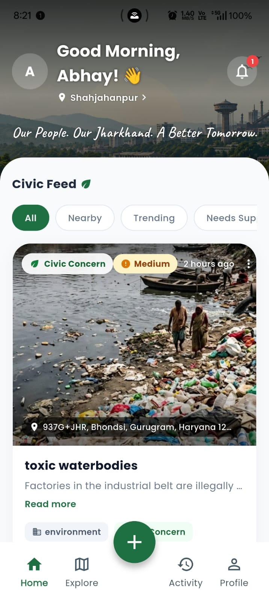 | 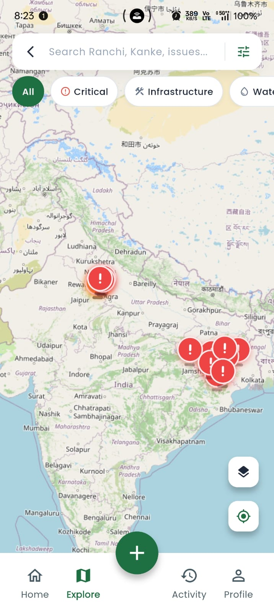 | 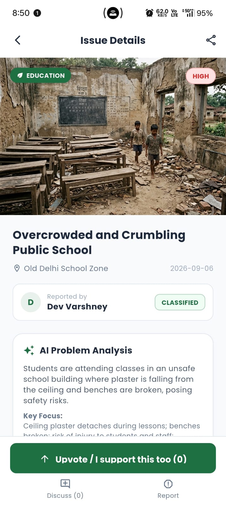 |

| Issue Details & AI Tags | Activity & Status Tracking | Media Evidence Upload |
| :---: | :---: | :---: |
| 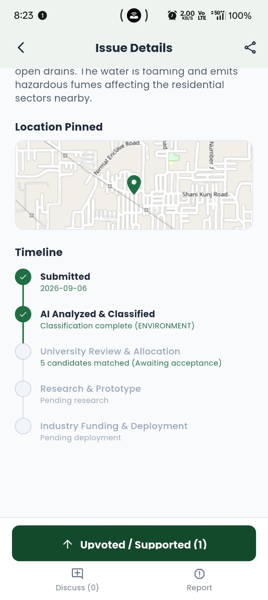 | 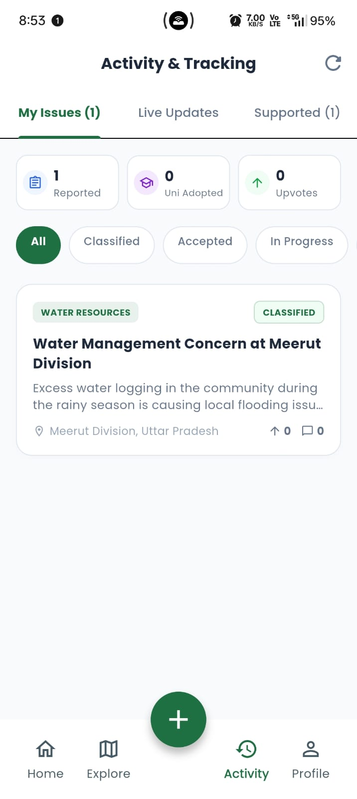 | 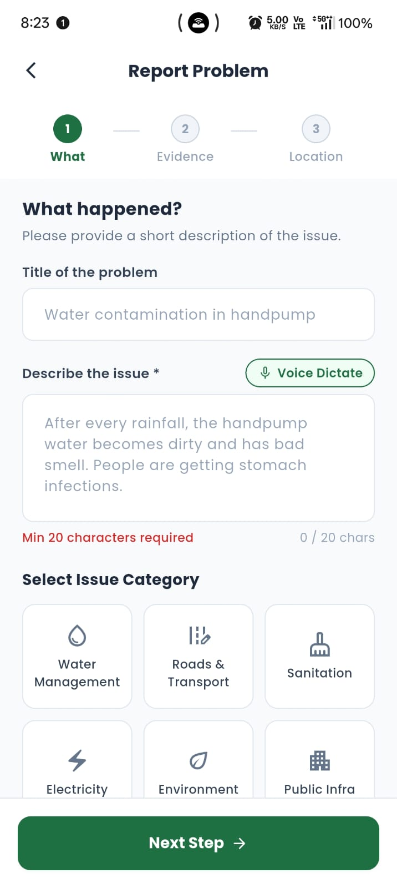 |

---

### 2. Web Portal & Institutional Dashboards (React + Vite + Tailwind)
The administrative and academic web portal connects universities, student innovators, and industrial partners to solve and scale grassroots solutions.

#### 🌐 Live Platform Interface
<p align="center">
  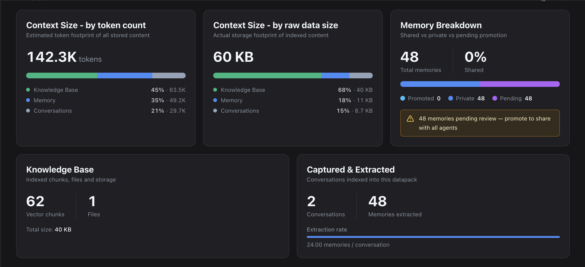
</p>

#### 🔍 Explore & Problem Deep-Dive
| Public Problem Feed & GIS Map | Problem Detail & AI University Allocation |
| :---: | :---: |
| 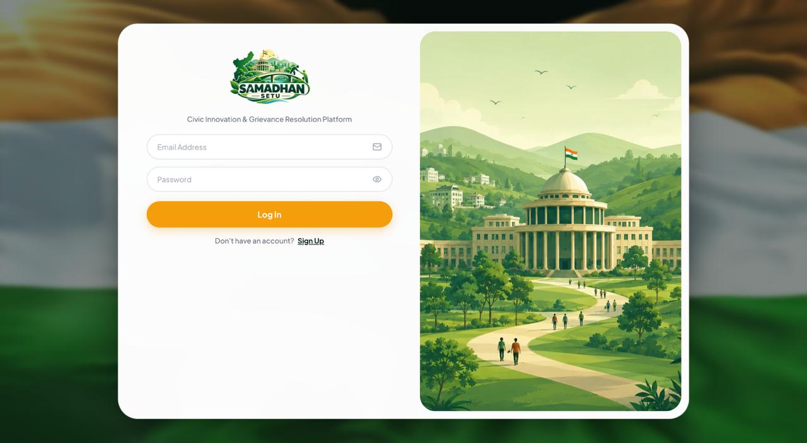 | 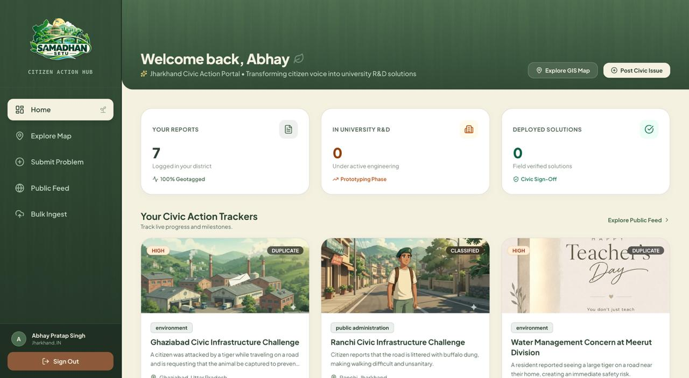 |

#### 🎓 University Challenge Management & Student Team Collaboration
| University Challenge Adoption Kanban | Team Formation & Milestone Tracking |
| :---: | :---: |
| 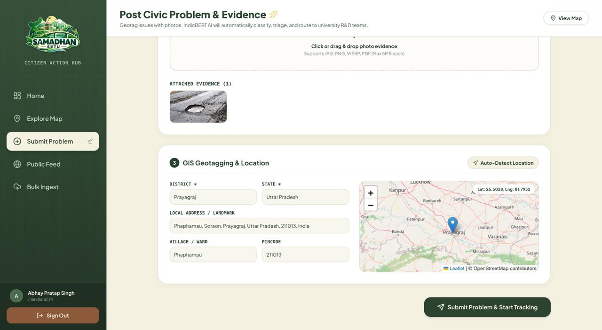 | 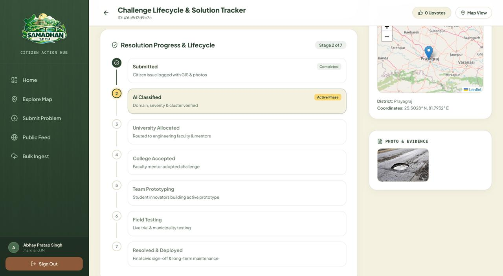 |

#### 🏢 Industry Scaling & Civic Analytics
| Industry CSR & Partner Matching | Ward-Level Civic Analytics |
| :---: | :---: |
| 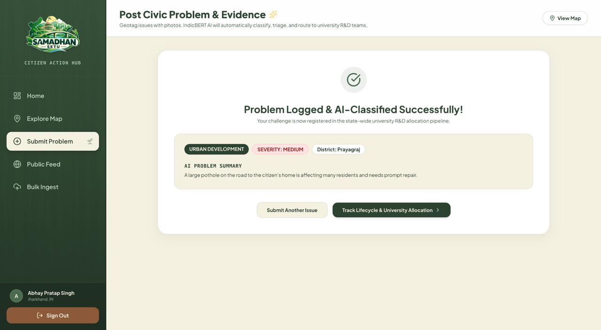 | 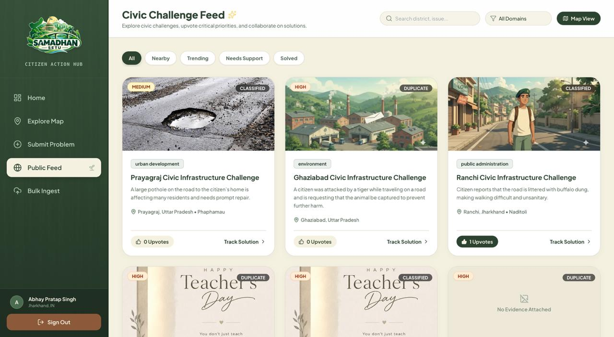 |

---

## 🏗️ System Architecture

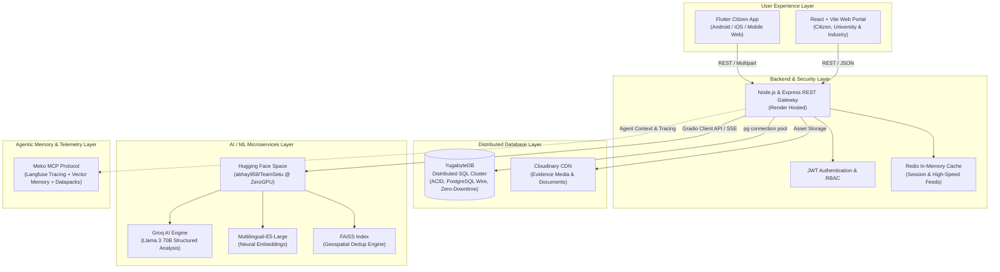

---

## 🌟 Spotlight: Use of YugabyteDB

<p align="center">
  
</p>

**Samadhan Setu leverages [YugabyteDB](https://www.yugabyte.com/) as its primary distributed SQL database engine**, replacing legacy single-instance databases with cloud-native resilience and horizontal scalability.

### Why YugabyteDB is Critical to Samadhan Setu:
1. **Distributed High Availability for Civic Scale**:
   Civic emergencies (natural disasters, road cave-ins, water contamination) generate localized query surges. YugabyteDB's Raft-based distributed architecture provides continuous availability and active-active multi-region survivability with zero data loss ($RPO = 0, RTO = 0$).
2. **PostgreSQL Wire Compatibility with Distributed ACID**:
   The backend connects through the native PostgreSQL `pg` pool driver with full TLS/SSL certificate encryption (`root.crt`). All transactions—from upvote increments to college problem allocations—maintain strict serializable/read-committed ACID guarantees across distributed nodes.
3. **Hybrid Relational + JSONB Document Model**:
   Samadhan Setu leverages YugabyteDB's advanced JSONB indexing to combine structured relational integrity with dynamic AI payloads:
   ```sql
   CREATE TABLE problem_statements (
       id UUID PRIMARY KEY DEFAULT gen_random_uuid(),
       title VARCHAR(500) NOT NULL,
       description TEXT NOT NULL,
       category VARCHAR(100),
       status VARCHAR(50) DEFAULT 'SUBMITTED',
       latitude DOUBLE PRECISION,
       longitude DOUBLE PRECISION,
       district VARCHAR(100),
       reported_by UUID REFERENCES users(id) ON DELETE SET NULL,
       ai_analysis JSONB DEFAULT '{}'::jsonb,
       college_suggestions JSONB DEFAULT '[]'::jsonb,
       company_suggestions JSONB DEFAULT '[]'::jsonb,
       media_urls TEXT[] DEFAULT ARRAY[]::TEXT[],
       upvotes INTEGER DEFAULT 0,
       created_at TIMESTAMP WITH TIME ZONE DEFAULT CURRENT_TIMESTAMP
   );
   ```
4. **Geo-Partitioned Spatial Performance**:
   Enables indexing across districts and coordinates (`idx_problems_district`, `idx_problems_category`) allowing fast sub-50ms spatial queries across millions of state records.

---

## 🧠 Spotlight: Use of MEKO Protocol

<p align="center">
  
</p>

**[Meko](https://meko.ai/) is integrated into Samadhan Setu's development and runtime agent lifecycle**, serving as the institutional memory and contextual telemetry engine.

### How Meko Powers Samadhan Setu:
1. **Persistent Cross-Session Agent Memory (`memory_add` / `context_search`)**:
   Architectural decisions, schema evolutions, environment configurations, and prompt calibrations are synchronized to Meko's vector collection under agent `antigravity:hackcbs` and pinned Datapack `4467fb86-f204-4aeb-9ba3-1af2370806e4`. This guarantees that autonomous development agents retain durable context across turns without manual prompt engineering.
2. **Langfuse Trace Nesting & Auditability (`conversation_add_message`)**:
   Every significant model turn, user direction, and validation action is recorded as an auditable trace span. This provides transparent observability into how civic policies, translation prompts, and deduplication thresholds evolved.
3. **Meko MCP Tools Integration**:
   - `conversation_add_message`: Logs execution actions, declarative plans, and rationale for every system enhancement.
   - `memory_add`: Persists critical project facts (e.g. ZeroGPU token configurations, YugabyteDB distributed schemas).
   - `knowledgebase_search` & `datapack_search`: Accelerates retrieval of domain criteria and civic guidelines.

---

## 🛠️ Complete Tech Stack

| Layer | Technologies & Frameworks | Purpose |
| :--- | :--- | :--- |
| **Mobile App** | Flutter 3, Dart, Provider / Bloc, Geolocator | Cross-platform citizen reporting with native camera and GPS integration |
| **Web Frontend** | React 18, TypeScript, Vite, Tailwind CSS, Lucide Icons | Responsive dashboards for citizens, universities, and industries |
| **Backend Core** | Node.js (v22), Express.js, JWT, Joi Validation | High-throughput asynchronous REST API gateway |
| **Distributed DB** | **YugabyteDB** (Distributed PostgreSQL Engine, TLS/SSL) | Resilient, distributed SQL store for all users, problems, and teams |
| **Caching & Queue** | Redis (ioredis) | Session management, rate limiting, and real-time upvote caching |
| **AI / ML Microservice** | Hugging Face Spaces (`abhay958/TeamSetu`), ZeroGPU | Remote serverless ML execution environment |
| **LLM Classification** | Groq API (`llama-3-70b-versatile`) | Real-time civic classification, urgency estimation & remedial tips |
| **Vector Embeddings** | `intfloat/multilingual-e5-large` (PyTorch) | 1024-dimensional dense semantic vectors for Hindi/English texts |
| **Deduplication** | FAISS (Facebook AI Similarity Search) | Millisecond geospatial vector deduplication |
| **Media CDN** | Cloudinary | Auto-optimized image/video evidence hosting |
| **Email Service** | Brevo (Sendinblue) API | Transactional OTPs, status updates, and university acceptance alerts |
| **Agent Telemetry** | **Meko MCP** (Langfuse & PgVector Mem0) | Continuous agent context, durable memory, and trace tracking |

---

## ⚡ Getting Started & Local Development

### Prerequisites
- Node.js (v18 or higher)
- Flutter SDK (v3.19 or higher)
- YugabyteDB Cluster or local PostgreSQL instance
- Redis Server
- Hugging Face User Access Token (with ZeroGPU access)

### 1. Backend Setup
```bash
cd backend
npm install

# Configure your environment variables in .env
cp .env.example .env
```

Ensure the following keys are provided in `backend/.env`:
```env
PORT=5001
NODE_ENV=development
DATABASE_URL=postgresql://<user>:<password>@<yugabyte-host>:5433/yugabyte?sslmode=require
DB_CA_CERT_PATH=root.crt
REDIS_URI=redis://<redis-host>:6379
HF_TOKEN=hf_your_hugging_face_token
GROQ_API_KEY=gsk_your_groq_api_key
CLOUDINARY_CLOUD_NAME=your_cloud_name
CLOUDINARY_API_KEY=your_cloudinary_key
CLOUDINARY_API_SECRET=your_cloudinary_secret
JWT_ACCESS_SECRET=your_jwt_secret
```

Start the backend server:
```bash
npm run dev
```

### 2. Frontend Web Setup
```bash
cd frontend
npm install
npm run dev
```
Open `http://localhost:5173` in your browser.

### 3. Citizen Mobile App Setup
```bash
cd citizen_app
flutter pub get
flutter run
```

---

## 👥 Authors & Acknowledgments

- **Team HackCBS / Samadhan Setu**
- Developed with advanced agentic pairing via Google DeepMind Antigravity.
- Built for civic impact and technological empowerment under national hackathon initiatives.
